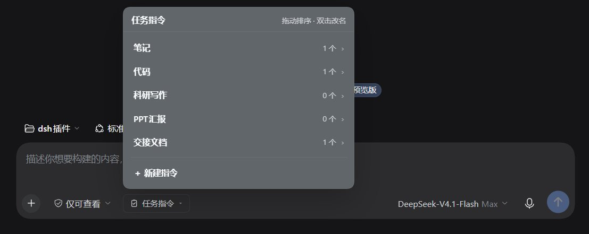
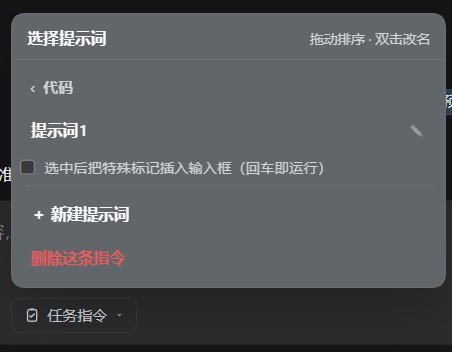
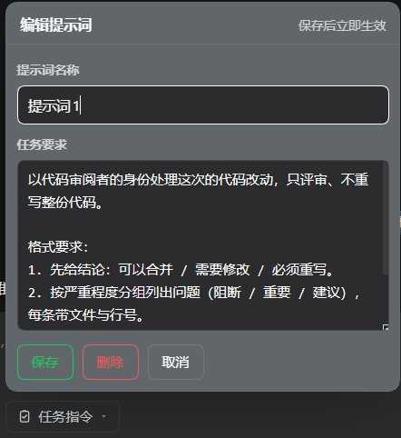

# 任务指令 · dsh-task-instructions

> 在 DeepSeek Harness 的输入框旁加一个「任务指令」按钮：把这次任务的固定要求（输出格式、结构、禁止事项……）存成一条提示词，点一下选中，**本会话每一轮都按它执行**——不用反复粘贴，上下文压缩也不会把它冲掉。



## 它解决什么问题

写长任务时，你通常要先粘一段「要求」：结论放最前、每条不超过两行、不要复述原文……这段话有三个麻烦：

- **每次都要重来**：新开一个任务，得把它从笔记里翻出来再粘一遍；
- **会话一长就走样**：上下文被压缩后，要求往往只剩摘要，格式约束最先变形；
- **靠自觉**：粘一次只管一轮，后面模型可能慢慢回到它自己的写法。

这个插件把那段要求变成可复用的「任务指令」，选中一次，整场会话都按它来。

## 功能与优点

|                    |                                                                              |
| ------------------ | ---------------------------------------------------------------------------- |
| **两级菜单**       | 指令（任务类型）→ 提示词，点两下选中，不用记命令                             |
| **整场会话生效**   | 要求放进 system prompt，每一轮都在；压缩只压对话消息，动不到它               |
| **不进对话气泡**   | 对话框里只有你自己写的那句话，不会出现一大段要求刷屏                         |
| **几乎不额外花钱** | 文本稳定、位于请求前缀，通常能命中模型侧的前缀缓存                           |
| **换会话互不影响** | 激活状态按会话记录，A 会话选「代码」不影响 B 会话                            |
| **现场编辑**       | 新建、改内容、改名字（双击名字）、拖动排序，全在面板里完成                   |
| **两种指令形态**   | 普通指令只改按钮；「指令型」指令选中后还会往输入框插一枚特殊标记，回车即运行 |
| **深浅色都清楚**   | 按钮与文字只用主题色，深色/浅色主题下都看得见                                |
| **零依赖**         | 纯 JavaScript，无构建步骤、无 npm 依赖，装完刷新即用                         |

## 看一眼

**① 点开「任务指令」，先选任务类型**


每行右边是这条指令下的提示词数量，`›` 进入下一级；底部可以新建指令。

**② 选一条提示词**



列表下方的复选框是这条**指令**的开关：勾上就变成「指令型」——选中它的提示词时，输入框里会多出一枚带名字的特殊标记，按回车即可运行；不勾则只改变按钮状态。

**③ 随时改、随时存**



名称和正文都能直接改；「保存」是绿色描边、「删除」是红色描边，深色主题下也清楚。

> 截图用的是作者自己的指令库；安装后自带的是「写作 / 代码 / 会议」三组示例，可以直接用，也可以改掉。

## 安装

需要 DeepSeek Harness 桌面版或 `dsh web`，装好后刷新页面生效。

### 从插件市场装

在市场里搜「任务指令」或 `dsh-task-instructions`，一键安装。

### 从 GitHub 装

```powershell
dsh plugin --profile desktop add github:you-qilin/dsh-task-instructions
```

### 从本地目录装

```powershell
dsh plugin --profile desktop add "<路径>/dsh-task-instructions"
```

> **装完刷新页面（`Ctrl+R`）**，按钮才会出现在输入框左侧工具行。
>
> 桌面端读的是 `desktop` profile：命令里漏掉 `--profile desktop` 会装进别的 profile，命令行提示成功但界面上看不到。

## 快速上手

1. 点输入框左边的 **任务指令**。
2. 选一条指令，比如 `写作`。
3. 选一条提示词，比如 `结构化摘要` —— 立即生效，本会话之后每一轮都按它执行。
4. 打个招呼，比如「把这份资料整理一下」，看输出是不是按固定格式来的。
5. 要换一条：再点按钮；要取消：面板顶部 **停用**。

安装后会自带三组示例（写作 / 代码 / 会议），可以直接用，也可以改掉或删掉。

### 日常操作

| 想做什么 | 怎么做                                         |
| -------- | ---------------------------------------------- |
| 改内容   | 点提示词行右侧的 `✎`                           |
| 改名字   | 双击指令名或提示词名，`Enter` 保存、`Esc` 取消 |
| 调顺序   | 按住一行拖到目标位置                           |
| 停用     | 面板顶部「停用」（只影响当前会话）             |
| 彻底不用 | 设置 → 插件里禁用或卸载；指令数据会保留        |

## 指令型指令

有些指令本身就是一句任务（比如「写一个交接文档」），选中后希望**马上能发出去**。把这条指令的开关打开：

> ☑ 选中后把特殊标记插入输入框（回车即运行）

之后选中它的提示词，输入框里会出现一枚带名字的标记（和 `@文件` 同一种节点，整体删除、复制行为一致），光标落在后面，直接回车即可运行。提交时标记会被替换成一句可执行的请求，同时 system prompt 里仍带着完整要求。

普通指令不受影响，仍然只是「换一下按钮上的名字」。

## 工作原理

选中的提示词会在**每一轮请求前**作为一段 system prompt 附加进去：

```xml
<task_instruction name="写作 / 结构化摘要" binding="mandatory" scope="session">
用户在本次会话中为这个任务设定了固定的任务要求……
任务要求原文：
<<<TASK
（你写的那段要求）
TASK>>>
</task_instruction>
```

因此对话记录干净、压缩不影响、成本很低；编辑提示词后不用重新选择，下一轮就按新内容执行；提示词被删掉会自动静默解除。

## 数据与备份

都在 DSH 数据目录（`$DSH_HOME`，默认 `~/.dsh`）：

| 文件                               | 内容                                         |
| ---------------------------------- | -------------------------------------------- |
| `dsh-task-instructions.json`       | 指令 → 提示词，人类可读的 JSON，可以直接手改 |
| `dsh-task-instructions.state.json` | 每个会话当前激活的提示词 id                  |

写入是原子的，不会留下写坏一半的文件；文件损坏时会先备份成 `.bak` 再重置。备份或换机时，把这两个文件一起拷走即可。

## 常见问题

**装完输入框旁边没有按钮？**
确认三件事：插件在「设置 → 插件」里是启用状态；装的是桌面端用的 `desktop` profile；装完刷新过页面。

**面板一直停在「读取任务指令…」？**
说明插件的后台部分没有加载成功。重载一次插件；仍然不行就看应用日志里有没有这个插件的报错。

**选了指令，模型却没按格式写？**
先看按钮上显示的是不是目标提示词；再看要求本身是否写清（结构、字段、禁止事项）。另外**新会话需要重新选一次**——激活状态是按会话记的，不会跨会话继承。

**会影响别的会话吗？**
不会。每个会话独立记录。

**和 `dsh-role-prompts`（岗位角色）冲突吗？**
不冲突。角色管「我是谁」，任务指令管「这次要什么」，是两段独立的 system prompt 片段，可以同时装、同时生效。

## English

A composer-side **task instruction** button for DeepSeek Harness. Save a requirement set once — output format, section structure, do-nots — pick it from a two-level menu (task type → prompt), and every turn of that session follows it. The text goes into the system prompt, so it never clutters the chat, survives context compaction, and stays cache-friendly. Instructions and prompts are created, renamed, reordered and edited right in the panel; data lives in `~/.dsh/dsh-task-instructions.json`.

```bash
dsh plugin --profile desktop add github:you-qilin/dsh-task-instructions
```

## License

MIT
